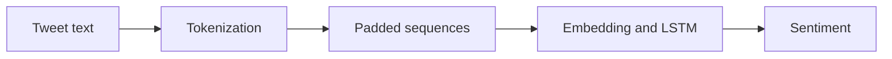

# Airline Sentiment Classification

### LSTM text classification for positive, neutral, and negative airline tweets.

**Python · Keras/TensorFlow · LSTM · NLP**

*Archived coursework / research prototype · Not actively maintained*

An archived notebook exploring airline-tweet sentiment classification with sequence models. It tokenizes text, pads sequences, and trains a neural classifier for three sentiment labels.

## What is included

- Tweet preprocessing and tokenization
- Embedding and LSTM-based classification
- Single-text prediction helper

The repository includes 1 directly browsable source/notebook file and a [source archive](source.zip) containing 1 file with their package structure preserved. See [SOURCE_INDEX.md](SOURCE_INDEX.md) for its contents. Reference components retain their labels and upstream notices.

## Workflow

*Diagram reconstructed from the recovered source or project description.*

## Explore / run

Open `sentiment-lstm.ipynb` in Jupyter or Colab. Supply the original Tweets.csv locally and update the notebook data path. Install the imported TensorFlow/Keras, pandas, and NumPy dependencies in a compatible environment.

### Direct source files

- [sentiment-lstm.ipynb](sentiment-lstm.ipynb)

## Project status

The original Tweets.csv is excluded because it contains user and location metadata. No fresh training or verified accuracy measurement is claimed.

No training, benchmark, paid API request, or external service deployment was performed to prepare this showcase. Team names, student IDs, raw personal documents, and embedded credentials are excluded from the public upload copies. Additional scope notes are in [SOURCE_NOTES.md](SOURCE_NOTES.md).
